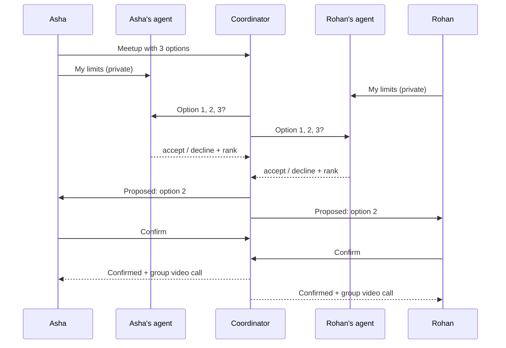

# Social agents and video calls

Circles helps members with shared interests find each other. Social agents take the next step: turning a connection into a real plan without anyone having to reveal their budget or calendar.

## How a meetup is agreed



1. **Start.** A member creates a meetup with 1 to 12 options (title, date, cost per person, tags) and invites up to eight of their accepted connections.
2. **Private limits.** Each participant gives their own agent their limits: maximum spend per person, free dates, interests and dietary needs.
3. **Negotiation.** For every option, each agent answers with a verdict only: accept or decline, and a preference rank from 0 to 3. An agent declines when the cost is above its owner's ceiling, the date is not one of the free dates, or the dietary need is not met. The rank rises with shared interests and when the cost is comfortably under the ceiling.
4. **Proposal.** The option every agent accepts with the highest combined rank is proposed. If no option is accepted by everyone, the meetup reports that nothing fits, without saying whose limit ruled an option out.
5. **Confirmation.** The meetup is confirmed only after every participant confirms it themselves. Changing your limits re-runs the negotiation and clears earlier confirmations.

## What is shared and what is not

| Shared with other participants | Never shared |
| --- | --- |
| The options | Your maximum budget |
| Per option: how many agents accept | Your free dates |
| The proposed option and why | Your interests and dietary needs as entered for the meetup |
| Who has given limits and who has confirmed | Which participant declined an option |

The API returns only your own limits (`my_constraints`). Other members' limits are not part of any response.

## Statuses

| Status | Meaning |
| --- | --- |
| `collecting` | Waiting for at least one participant's limits |
| `proposed` | The agents agreed on an option; waiting for confirmations |
| `confirmed` | Everyone confirmed; the group video call is available |
| `no_agreement` | No option suits everyone; add options or relax a limit |

## Video calls

- **One to one.** In Circles, connected members see a **Video call** button. It opens a private Jitsi Meet room whose name is derived from the connection, so both members get the same room and nobody else can guess it.
- **Group.** A confirmed meetup shows **Join group video call** to its participants.
- Calls are refused for members who are not connected or who have blocked each other. A block between any two participants also closes their shared meetups to both of them.

## Safety rules

- Meetups can only include your accepted connections. Community profiles are opt-in, adult-confirmed and show city-level location only.
- Blocking and reporting are available on every connection.
- Nothing is booked or paid for by a meetup. Use the budget planner and approvals for that.

## API

```bash
# Organiser
curl -b jar -H 'X-Requested-With: lifecanvas' -H 'Content-Type: application/json' -d '{
  "title": "Saturday out",
  "options": [
    {"title": "Jazz club", "date": "2026-12-05", "cost_per_person": 1800, "currency": "INR", "tags": ["jazz"]},
    {"title": "Open mic night", "date": "2026-12-05", "cost_per_person": 400, "currency": "INR", "tags": ["music"]}],
  "invitees": ["<connection user_id>"],
  "constraints": {"max_budget": 2000, "dates": ["2026-12-05"], "interests": ["jazz"]}}' \
  http://localhost:8000/api/meetups

# Invitee
curl -b jar2 -H 'X-Requested-With: lifecanvas' -H 'Content-Type: application/json' \
  -d '{"constraints": {"max_budget": 600, "interests": ["music"]}}' \
  http://localhost:8000/api/meetups/<id>/constraints

# Each participant
curl -b jar -X POST -H 'X-Requested-With: lifecanvas' http://localhost:8000/api/meetups/<id>/confirm
```

Constraint keys: `max_budget` (number), `dates` (list of `YYYY-MM-DD`), `interests` (list), `diet` (string, matched against an option's `diets` list when the option has one).

A meetup view contains `id, title, status, organiser, options, outcome, chosen, my_constraints, members, video_call`. `outcome.rounds` lists, per option, how many agents accepted. `video_call` is set only when the status is `confirmed`.

## Limits

- Negotiation is deterministic constraint matching. Agents do not hold a model-driven conversation, counter-propose new options or search for alternatives on their own.
- Video rooms are hosted by the public Jitsi Meet service, which does not check LifeCanvasOS membership. A link that was already opened or copied keeps working after a block. Closing that gap needs a self-hosted Jitsi with token authentication or another video provider.
- Dates are matched exactly; there is no time-of-day or travel-time reasoning.
- Costs in different currencies are compared as plain numbers, so keep one currency per meetup.
